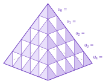

<!-- GÉNÉRÉ par typweb à partir des notes Typst : NE PAS ÉDITER (les modifications seraient écrasées). -->

::: {#activite-2-1 data-sorte="activite" data-num="2.1" data-page="12" data-phys="14" data-id="5UAA2.pyramide-louvre" data-type="activite" data-tags="" .theo .theo-activite}
::: {.theo-head}
**Activité 2.1** — la pyramide du Louvre
:::

::: {.theo-body}
La face triangulaire d’une pyramide de verre est tapissée de petits triangles. La rangée du sommet compte $1$ triangle par face, la suivante $3$ par face et ainsi de suite. On note $u_{n}$ le nombre de triangles de la rangée de rang $n$, à partir du sommet ($n = 0$).

::: {.typst-fig}
{fig-alt="Figure du cours"}
:::

a) Complète le tableau :

::: {.tableau}
| $n$ | $0$ | $1$ | $2$ | $3$ | $4$ | $5$ | $6$ |
|:---:|:---:|:---:|:---:|:---:|:---:|:---:|:---:|
| $u_{n}$ | $4$ | $12$ | [$20$]{.rep} | [$28$]{.rep} | [$36$]{.rep} | [$44$]{.rep} | [$52$]{.rep} |
:::

b) Comment obtient-on $u_{n}$ à partir du rang $n$ ? $u_{n} =$ [$8 n + 4$]{.rep}

c) Une face compte $12$ rangées ($n$ varie de $0$ à [$11$]{.rep}). Combien de triangles à la dernière rangée ? $u_{11} =$ [$8 \cdot 11 + 4 = 92$]{.rep}

d) Représente les premiers termes. Les points sont-ils alignés ?

```{=html}
<div class="ia" data-ia="suite" data-cfg='{"points": [[0.0, 4.0], [1.0, 12.0], [2.0, 20.0], [3.0, 28.0], [4.0, 36.0], [5.0, 44.0], [6.0, 52.0]], "nmax": 7, "ymin": 0.0, "ymax": 60.0, "fixe": true, "ypas": 10.0, "n0": 0, "largeur": 520, "hauteur": 292, "cache": true}'></div>
```

::: {.rep-bloc}
Oui : les points sont **alignés**. Une suite arithmétique a une croissance **linéaire** (les points suivent une droite).
:::

e) Combien de triangles y a-t-il pour toute pyramide ? Il faut calculer la somme $S_{12} = u_{0} + u_{1} + \ldots + u_{11}$. Plutôt que tout additionner, utilisons l’astuce de **Gauss** : apparions les termes extrêmes.

::: {.grille style="--n:2"}
::: {.cellule}
::: {.tableau}
| paire | somme |
|:---:|:---:|
| $u_{0} + u_{11}$ | [$4 + 92 = 96$]{.rep} |
| $u_{1} + u_{10}$ | [$12 + 84 = 96$]{.rep} |
| $u_{2} + u_{9}$ | [$20 + 76 = 96$]{.rep} |
:::
:::

::: {.cellule}
::: {.tableau}
| paire | somme |
|:---:|:---:|
| $u_{3} + u_{8}$ | [$28 + 68 = 96$]{.rep} |
| $u_{4} + u_{7}$ | [$36 + 60 = 96$]{.rep} |
| $u_{5} + u_{6}$ | [$44 + 52 = 96$]{.rep} |
:::
:::
:::

Donc $S_{12} = 6 \times 96 =$ [$576$]{.rep} triangles.

f) Généralisons. Il y a $n$ termes, soit $\frac{n}{2}$ paires, chacune valant $u_{0} + u_{n-1}$. Donc pour une suite arithmétique : $S_{n} =$ [$\frac{n}{2} (u_{0} + u_{n-1})$]{.rep}
:::
:::

::: {.ae-lien}
[✔ S'autoévaluer sur cette section : test de 1 question →](../autoeval.qmd#sections=sec-pyramide)
:::
