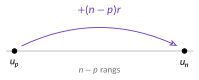

<!-- GÉNÉRÉ par typweb à partir des notes Typst : NE PAS ÉDITER (les modifications seraient écrasées). -->

## Relation de récurrence et formule explicite

::: {#propriete-2-2 data-sorte="propriete" data-num="2.2" data-page="14" data-phys="17" data-id="5UAA2.generation" data-type="propriete" data-tags="" .theo .theo-propriete}
::: {.theo-head}
**Propriété 2.2** — génération
:::

::: {.theo-body}
Soit $(u_{n})$ une suite arithmétique de raison $r$ et de premier terme $u_{0}$.

- **Relation de récurrence** : $u_{n+1} = u_{n} + r$.
- **Formule explicite** : $u_{n} = u_{0} + n r$.
:::
:::

::: {#exemple-2-2 data-sorte="exemple" data-num="2.2" data-page="14" data-phys="17" data-id="5UAA2.exm.002" data-type="exemple" data-tags="" .theo .theo-exemple}
::: {.theo-head}
**Exemple 2.2**
:::

::: {.theo-body}
Suite arithmétique de raison $r = 7$ et de premier terme $u_{0} = -4$. Récurrence : $u_{n+1} = u_{n} + 7$. Formule explicite : $u_{n} = -4 + 7 n$. Ainsi $u_{1000} = -4 + 7 \cdot 1000 = 6996$.
:::
:::

## Calculer un terme à partir d’un autre

Le premier terme d’une suite n’est pas toujours $u_{0}$ : on doit savoir passer d’un terme *quelconque* $u_{p}$ à un autre $u_{n}$. Observons deux cas.

::: {#exemple-2-3 data-sorte="exemple" data-num="2.3" data-page="15" data-phys="17" data-id="5UAA2.42-e-terme-17-e" data-type="exemple" data-tags="" .theo .theo-exemple}
::: {.theo-head}
**Exemple 2.3** — du 42^e^ terme au 17^e^
:::

::: {.theo-body}
Une suite arithmétique a pour raison $r = 3$ et l’on connaît $u_{42} = 100$. Cherchons $u_{17}$. Pour passer du rang $42$ au rang $17$, on recule de $17 - 42 = -25$ rangs, en retirant $25$ fois la raison :

$$
u_{17} = u_{42} + (17 - 42) \cdot r = 100 + (-25) \cdot 3 = 100 - 75 = 25.
$$
:::
:::

::: {#exemple-2-4 data-sorte="exemple" data-num="2.4" data-page="15" data-phys="17" data-id="5UAA2.58-e-terme-3-e" data-type="exemple" data-tags="" .theo .theo-exemple}
::: {.theo-head}
**Exemple 2.4** — du 58^e^ terme au 3^e^
:::

::: {.theo-body}
Une suite arithmétique a pour raison $r = -4$ et $u_{58} = 200$. Cherchons $u_{3}$. On passe du rang $58$ au rang $3$ : $3 - 58 = -55$ rangs.

$$
u_{3} = u_{58} + (3 - 58) \cdot r = 200 + (-55) \cdot (-4) = 200 + 220 = 420.
$$
:::
:::

::: {#activite-2-2 data-sorte="activite" data-num="2.2" data-page="15" data-phys="18" data-id="5UAA2.generalise" data-type="activite" data-tags="" .theo .theo-activite}
::: {.theo-head}
**Activité 2.2** — généralise
:::

::: {.theo-body}
En observant les deux exemples ci-dessus, comment calcules-tu $u_{n}$ à partir d’un terme $u_{p}$ *quelconque*, pour une suite arithmétique de raison $r$ ?

::: {.typst-fig}
{fig-alt="Figure du cours"}
:::

$u_{n} =$ [$u_{p} + (n - p) r$]{.rep}
:::
:::

::: {#propriete-2-3 data-sorte="propriete" data-num="2.3" data-page="15" data-phys="18" data-id="5UAA2.terme-autre" data-type="propriete" data-tags="" .theo .theo-propriete}
::: {.theo-head}
**Propriété 2.3** — d’un terme à un autre
:::

::: {.theo-body}
Pour une suite arithmétique de raison $r$ et pour tous rangs $n$ et $p$ :

$$
u_{n} = u_{p} + (n - p) r.
$$
:::
:::

## Calculer la raison à partir de deux termes

Si l’on connaît deux termes $u_{p}$ et $u_{n}$, la propriété précédente permet de trouver la raison : de $u_{n} = u_{p} + (n - p) r$ on tire la raison en isolant $r$.

::: {#exemple-2-5 data-sorte="exemple" data-num="2.5" data-page="15" data-phys="18" data-id="5UAA2.exm.003" data-type="exemple" data-tags="" .theo .theo-exemple}
::: {.theo-head}
**Exemple 2.5**
:::

::: {.theo-body}
Une suite arithmétique vérifie $u_{9} = 30$ et $u_{21} = 120$. La raison est

$$
r = \frac{u_{21} - u_{9}}{21 - 9} = \frac{120 - 30}{12} = \frac{90}{12} = 7{,}5.
$$
:::
:::

::: {#propriete-2-4 data-sorte="propriete" data-num="2.4" data-page="16" data-phys="18" data-id="5UAA2.raison-partir-deux-termes" data-type="propriete" data-tags="" .theo .theo-propriete}
::: {.theo-head}
**Propriété 2.4** — raison à partir de deux termes
:::

::: {.theo-body}
Pour une suite arithmétique et deux rangs distincts $n \neq p$ :

$$
r = \frac{u_{n} - u_{p}}{n - p}.
$$
:::
:::

::: {.ae-lien}
[✔ S'autoévaluer sur cette section : test de 4 questions →](../autoeval.qmd#sections=sec-arith-generer)
:::
