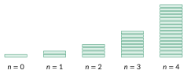

<!-- GÉNÉRÉ par typweb à partir des notes Typst : NE PAS ÉDITER (les modifications seraient écrasées). -->

::: {#activite-3-1 data-sorte="activite" data-num="3.1" data-page="22" data-phys="25" data-id="5UAA2.plier-feuille" data-type="activite" data-tags="" .theo .theo-activite}
::: {.theo-head}
**Activité 3.1** — plier une feuille
:::

::: {.theo-body}
Une feuille de papier a une épaisseur de $0{,}1$ mm. On la plie en deux, puis encore en deux, et ainsi de suite. On note $t_{n}$ l’épaisseur (en mm) après $n$ pliages; en particulier $t_{0} = 0{,}1$.

::: {.typst-fig}
{fig-alt="Figure du cours"}
:::

a) Complète le tableau (épaisseur en mm) :

::: {.tableau}
| $n$ | $0$ | $1$ | $2$ | $3$ | $4$ | $5$ | $6$ |
|:---:|:---:|:---:|:---:|:---:|:---:|:---:|:---:|
| $t_{n}$ | $0{,}1$ | $0{,}2$ | [$0{,}4$]{.rep} | [$0{,}8$]{.rep} | [$1{,}6$]{.rep} | [$3{,}2$]{.rep} | [$6{,}4$]{.rep} |
:::

b) Comment calculer $t_{n}$ à partir de $n$ ? $t_{n} =$ [$0{,}1 \cdot 2^{n}$]{.rep} mm.

c) Représente les premiers termes. Les points sont-ils alignés ?

```{=html}
<div class="ia" data-ia="suite" data-cfg='{"points": [[0.0, 0.1], [1.0, 0.2], [2.0, 0.4], [3.0, 0.8], [4.0, 1.6], [5.0, 3.2], [6.0, 6.4]], "nmax": 7, "ymin": 0.0, "ymax": 7.0, "fixe": true, "ypas": 1.0, "n0": 0, "largeur": 520, "hauteur": 292, "cache": true, "ylabel": "tₙ"}'></div>
```

::: {.rep-bloc}
Non : les points ne sont **pas alignés**, ils suivent une courbe qui monte de plus en plus vite (**croissance exponentielle**).
:::

d) Quelle épaisseur après $10$ pliages ? $t_{10} =$ [$0{,}1 \cdot 2^{10} =102{,}4$ mm $\approx 10$ cm]{.rep}

Et après $20$ pliages ? $t_{20} =$ [$0{,}1 \cdot 2^{20} \approx 105$ m !]{.rep}

e) La distance entre la Terre et la Lune vaut environ 400 000km. Combien de pliages faudrait-il réaliser pour atteindre cette distance? [42 pliage: $t_{42} \approx 439804$ km]{.rep}
:::
:::

::: {.ae-lien}
[✔ S'autoévaluer sur cette section : test de 1 question →](../autoeval.qmd#sections=sec-pliage)
:::
