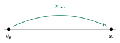

<!-- GÉNÉRÉ par typweb à partir des notes Typst : NE PAS ÉDITER (les modifications seraient écrasées). -->

## Relation de récurrence et formule explicite

::: {#propriete-3-2 data-sorte="propriete" data-num="3.2" data-page="24" data-phys="27" data-id="5UAA2.generation-2" data-type="propriete" data-tags="" .theo .theo-propriete}
::: {.theo-head}
**Propriété 3.2** — génération
:::

::: {.theo-body}
Soit $(u_{n})$ une suite géométrique de raison $q$ et de premier terme $u_{0}$.

- **Relation de récurrence** : $u_{n+1} = q \cdot u_{n}$.
- **Formule explicite** : $u_{n} = u_{0} \cdot q^{n}$.
:::
:::

::: {#exemple-3-2 data-sorte="exemple" data-num="3.2" data-page="24" data-phys="27" data-id="5UAA2.exm.005" data-type="exemple" data-tags="" .theo .theo-exemple}
::: {.theo-head}
**Exemple 3.2**
:::

::: {.theo-body}
Suite géométrique de raison $q = 3$ et de premier terme $u_{0} = -4$. Récurrence : $u_{n+1} = 3 u_{n}$. Formule explicite : $u_{n} = -4 \cdot 3^{n}$. Ainsi $u_{5} = -4 \cdot 3^{5} = -4 \cdot 243 = -972$.
:::
:::

## Calculer un terme à partir d’un autre

Comme pour les suites arithmétiques, on peut passer d’un terme à l’autre, sans nécessairement passer par le terme initial.

::: {#exemple-3-3 data-sorte="exemple" data-num="3.3" data-page="24" data-phys="28" data-id="5UAA2.4-e-terme-9-e" data-type="exemple" data-tags="" .theo .theo-exemple}
::: {.theo-head}
**Exemple 3.3** — du 4^e^ terme au 9^e^
:::

::: {.theo-body}
On considère une suite géométrique de raison $q = 3$ avec $u_{4} = 2$. Pour passer du rang $4$ au rang $9$, on avance de $9 - 4 = 5$ rangs, en multipliant $5$ fois par la raison :

$$
u_{9} = u_{4} \cdot q^{9 - 4} = 2 \cdot 3^{5} = 2 \cdot 243 = 486.
$$
:::
:::

::: {#exemple-3-4 data-sorte="exemple" data-num="3.4" data-page="25" data-phys="29" data-id="5UAA2.20-e-terme-15-e" data-type="exemple" data-tags="" .theo .theo-exemple}
::: {.theo-head}
**Exemple 3.4** — du 20^e^ terme au 15^e^
:::

::: {.theo-body}
On considère une suite géométrique de raison $q = 2$ avec $u_{20} = 1000$. On recule de $15 - 20 = -5$ rangs :

$$
u_{15} = u_{20} \cdot q^{15 - 20} = 1000 \cdot 2^{-5} = \frac{1000}{32} = 31{,}25.
$$
:::
:::

::: {#activite-3-2 data-sorte="activite" data-num="3.2" data-page="25" data-phys="29" data-id="5UAA2.generalise-2" data-type="activite" data-tags="" .theo .theo-activite}
::: {.theo-head}
**Activité 3.2** — généralise
:::

::: {.theo-body}
En observant les deux exemples ci-dessus, comment calcules-tu $u_{n}$ à partir d’un terme $u_{p}$ *quelconque*, pour une suite géométrique de raison $q$ ?

::: {.typst-fig}
{fig-alt="Figure du cours"}
:::

$u_{n} =$ [$u_{p} \cdot q^{n - p}$]{.rep}
:::
:::

::: {#propriete-3-3 data-sorte="propriete" data-num="3.3" data-page="25" data-phys="29" data-id="5UAA2.terme-autre-2" data-type="propriete" data-tags="" .theo .theo-propriete}
::: {.theo-head}
**Propriété 3.3** — d’un terme à un autre
:::

::: {.theo-body}
Pour une suite géométrique de raison $q$ et pour tous rangs $n$ et $p$ :

$$
u_{n} = u_{p} \cdot q^{n - p}.
$$
:::
:::

## Calculer la raison à partir de deux termes

Si l’on connaît deux termes $u_{p}$ et $u_{n}$, avec $n>p$, la relation $u_{n} = u_{p} \cdot q^{n-p}$ donne $q^{n-p} = \frac{u_{n}}{u_{p}}$. Pour trouver la raison, on doit se débarrasser de l’exposant $n-p$: il faut alors extraire une **racine**, en prenant en compte la parité de l’exposant :

::: {.callout-important title="Attention à la parité de l'exposant"}
- si $n - p$ est **impair**, la racine a un seul signe possible : $q$ est déterminé de façon unique (il a le signe de $\frac{u_{n}}{u_{p}}$) ;
- si $n - p$ est **pair**, il y a **deux valeurs possibles**, opposées : $q = \pm \sqrt[n-p]{u_{n} / u_{p}}$.
:::

::: {#exemple-3-5 data-sorte="exemple" data-num="3.5" data-page="25" data-phys="29" data-id="5UAA2.trois-cas" data-type="exemple" data-tags="" .theo .theo-exemple}
::: {.theo-head}
**Exemple 3.5** — trois cas
:::

::: {.theo-body}
- $u_{2} = 6$ et $u_{5} = 20{,}25$ : $q^{3} = 20{,}25 / 6 = 3{,}375$. L’exposant $3$ est **impair**, donc $q = \sqrt[3]{3{,}375} = 1{,}5$ (unique).
- $u_{2} = 6$ et $u_{5} = -20{,}25$ : $q^{3} = -3{,}375$, exposant impair, donc $q = -1{,}5$.
- $u_{2} = 6$ et $u_{6} = 30{,}375$ : $q^{4} = 30{,}375 / 6 = 5{,}0625$. L’exposant $4$ est **pair**, donc $q = \pm \sqrt[4]{5{,}0625} = \pm 1{,}5$ (deux suites conviennent).
:::
:::

::: {#propriete-3-4 data-sorte="propriete" data-num="3.4" data-page="26" data-phys="30" data-id="5UAA2.raison-partir-deux-termes-2" data-type="propriete" data-tags="" .theo .theo-propriete}
::: {.theo-head}
**Propriété 3.4** — raison à partir de deux termes
:::

::: {.theo-body}
Pour une suite géométrique et deux rangs $n>p$, on a $q^{n-p} = u_{n} / u_{p}$, d’où :

- si $n - p$ est **impair** : $q = \sqrt[n-p]{u_{n} / u_{p}}$ ;
- si $n - p$ est **pair** : $q = \pm \sqrt[n-p]{u_{n} / u_{p}}$.
:::
:::

::: {.ae-lien}
[✔ S'autoévaluer sur cette section : test de 4 questions →](../autoeval.qmd#sections=sec-geo-generer)
:::
